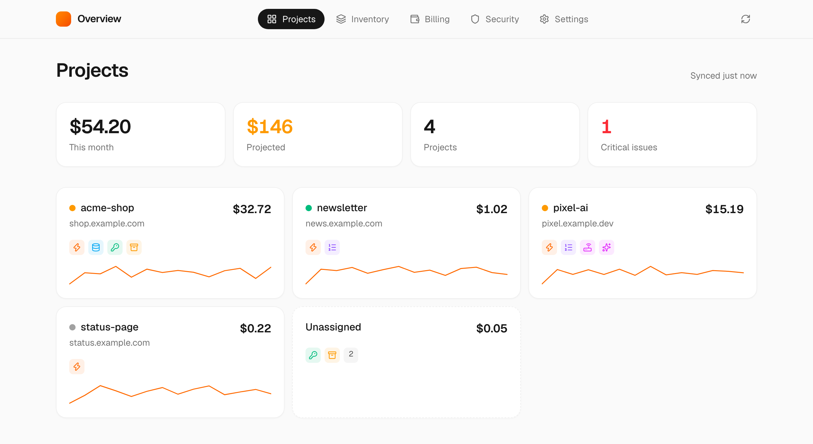
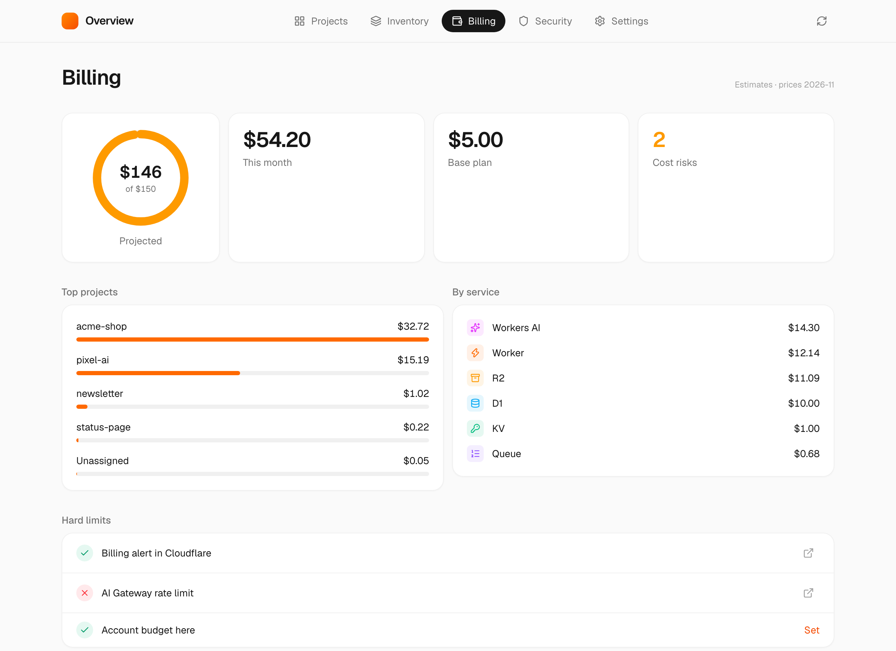
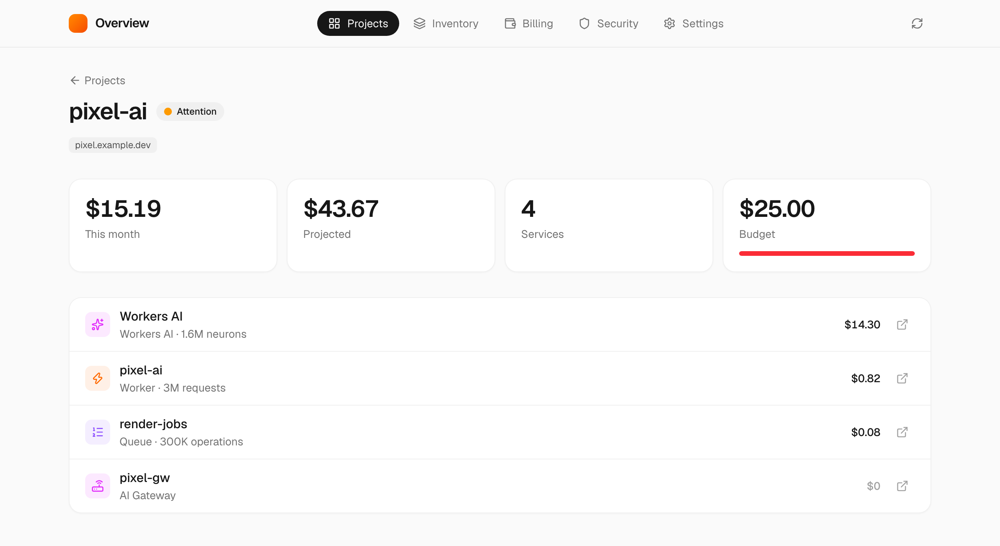

# Overview for Cloudflare

Your whole Cloudflare account on one simple page.



- **Projects**: Workers, databases, buckets and queues, grouped automatically.
- **Costs**: per project, this month and projected.
- **Security**: risky settings, in plain words.
- **Stop button**: pause a runaway project in one click. Slack alerts.

| | |
| --- | --- |
|  |  |

## Try it

```sh
npm install
npm run demo
```

Opens a demo account at http://localhost:3000. No Cloudflare login needed.

## Deploy

1. `npx wrangler d1 create cf-overview` and paste the id into `wrangler.jsonc`.
2. Fill in the other `REPLACE_WITH_…` values in `wrangler.jsonc`.
3. Put the hostname behind [Cloudflare Access](https://one.dash.cloudflare.com/) and copy its AUD tag and team domain into `wrangler.jsonc`.
4. `npx wrangler secret put CF_READ_TOKEN` with an API token from the "Read all resources" template.
5. `npm run db:migrate && npm run deploy`

Optional secrets: `CF_STOP_TOKEN` for the stop button (Workers Scripts, Queues and Workers Routes: Edit) and `ALERT_WEBHOOK_URL` for Slack.

Runs in your own account as one Worker and one D1 database. Costs are estimates from list prices.

## License

MIT
